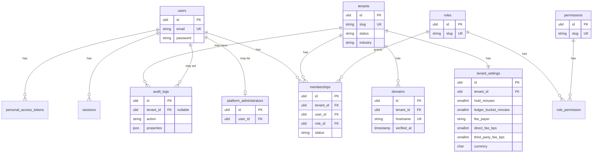

# Schema

Spec Section 13 lists the entities. This document says which of them exist in MySQL today. Timezone belongs on `locations`. Every timestamp that is stored is UTC.

## Migrated now

`users.id` is a ULID. `sessions.user_id` and Sanctum's `personal_access_tokens.tokenable` use ULIDs as well. `audit_logs.tenant_id` is nullable because platform actions are not tenant-owned. Roles and permissions are system rows, not per tenant. `/staff/audit` lists the latest 50 rows for an owner or manager with `audit.view` who is not limited to specific locations. The action filter is an exact match. The page does not write a row. Another workspace's rows are not listed. Staff cannot open it.

`tenants.industry` is one of the eighteen industry keys, default `boat_rentals`. It chooses staff vocabulary. It does not change inventory, pricing, or fees. Migration `database/migrations/2026_10_25_000438_add_industry_to_tenants_table.php`.

`memberships` is already the link between a user and a workspace. `users` has no `tenant_id`. The unique key is `(tenant_id, user_id)`, and `role_id` is that person's role in that one workspace. One login can own one business and be staff in another. No second membership table was added, and no existing membership rows were moved. A pending invitation uses the same row with status `invited`, plus `invite_token_hash` (SHA-256, nullable) and `invite_expires_at`. The plain token is not stored. `users.password_set_at` is set when a person chooses a password. It stays empty for an account created only to hold an invitation. Migration `database/migrations/2026_10_25_120000_add_team_invite_columns.php`.

`signup_acceptances` is one row per workspace created at `/signup`. Columns are `tenant_id` (unique), `user_id`, `terms_version`, and `accepted_at`. The version is the text the owner accepted. `accepted_at` is the time they checked the box. Migration `database/migrations/2026_10_24_260000_create_signup_acceptances_table.php`.

`staff_entry_tokens` stores the SHA-256 hash of a 64-character hex token used to sign in on another workspace's host. Columns are `user_id`, `tenant_id`, `token_hash` (unique), `expires_at`, `consumed_at`, and `created_at`. The plain token is not stored. It expires after two minutes. It is consumed once, and only when the host's tenant matches `tenant_id` and the user still has an active membership there. A different host does not consume it. Migration `database/migrations/2026_10_24_250000_create_staff_entry_tokens_table.php`.

`tenant_settings` stores fee rates and payer, hold length, ledger bucket, currency, `pay_at_pickup` (default false), `timezone` (default `America/New_York`), and `email_payment_receipt` (default false). An owner or manager turns receipt email on at `/staff/settings`. Staff can see that switch and cannot change it. Off records a skip and does not email a receipt. The column does not change a price, a fee, a tax, or a refund. Migration `2026_10_27_005614_add_email_payment_receipt_to_tenant_settings.php`. Currency defaults to `USD` and is not writable by a tenant until launch markets are decided. Fee rates are writable only by a platform administrator. The fee calculation engine is not in the database. `pay_at_pickup` is changed by a member with `settings.update`. The demo shop seeder sets it for Harbor Demo and Inland Demo only.

`tenant_brandings` stores the workspace display name, an optional external `logo_url` or a private `logo_path` on the local disk, `primary_color` and `accent_color` (`#RRGGBB`), and optional support email and phone. Defaults are the workspace name, `#0E7C86`, and `#F26B3A`. `GET` and `PATCH /api/v1/branding` read and update that row for the workspace resolved from the host. `GET /api/v1/branding/logo` serves the uploaded file for that same host and ignores any other path. Owner and manager (`settings.update`) can change it. Staff (`settings.view`) can read it. A new workspace gets a row when it is created. Existing views receive the current workspace as `workspaceBranding` from a view composer. Layouts are unchanged until they read that variable.

`tenant_notification_settings` stores `reply_to`, `staff_alert_recipients` (up to 20 email addresses), `transactional_emails`, `feedback_delay_minutes` (default 120, maximum 10080), and an optional `review_url`. Every known kind starts on: `booking.confirmed`, `booking.cancelled`, `booking.guest_cancelled`, `booking.guest_rescheduled`, `booking.checked_out`, `booking.returned`, `booking.reminder`, `booking.feedback`, `payment.completed`, `payment.failed`, `refund.issued`, `rental.overdue`, `waitlist.joined`, and `waitlist.promoted`. `GET` and `PATCH /api/v1/notification-settings` use the same owner and manager permission. A partial `transactional_emails` object changes only the kinds it names. `review_url` must be an https address with no username or password, or empty. Notification hooks are still queued. `App\Services\Notifications\TransactionalEmailPreferences` is what a mailer checks before it sends.

Foundation migration: `database/migrations/2026_10_23_170000_create_foundation_tables.php`. Laravel cache, jobs, and sessions tables are also migrated.

## Inventory resources

`locations.timezone` is the IANA zone for that place. `locations.booking_fee_taxable` defaults to false. When it is true, a new quote adds the customer booking fee to each of that location's tax rates that apply to rentals. `tenant_settings.timezone` is the business zone. A new location starts there. A guest or staff clock uses the location zone when that value is a real IANA name, otherwise the business zone. The last resort is `America/New_York`. The confirmation email uses that clock for the visit’s start and end, including both abbreviations when the visit crosses a daylight-saving change, and it includes the short booking reference. Stored instants stay UTC. `assets` are individually tracked and `pools.quantity` is the live capacity. Buffers are minutes on the asset or pool. Status is `active`, `blocked`, `maintenance`, or `retired`. `assets.replacement_asset_id` is empty until `POST /api/v1/assets/{asset}/retire` names another active asset in the same category and location. A retired asset stays in the workspace. A pool cannot be retired. Setting a pool to `maintenance` or `blocked`, through `PATCH /api/v1/pools/{pool}` or the status list on `/staff/setup/resources`, writes `bookings.attention_reason` on future held and confirmed bookings that use that pool. The booking stays booked. Changing `pools.quantity` does not flag those bookings. Setting the pool back to `active` leaves the flag. That same status list sets an asset to `maintenance` or `blocked` and flags its future bookings the same way `PATCH /api/v1/assets/{asset}` already did.

`availability_schedules` belong to a location, asset, or pool (`owner_type`, `owner_id`). `weekday` is Carbon's `0` Sunday through `6` Saturday. `blackouts.location_id` null covers the whole tenant. `closures` are separate from blackouts: one location, a reason, an optional category or a single asset or pool, `all_day` or `starts_local`/`ends_local`, and `recurs_yearly` for the same month and day each year. `services.kind` is `rental` or `tour`. `services.min_participants` and `services.max_participants` are optional. `services.waitlist_enabled` allows a refused hold to be stored as a waitlist entry. `service_durations` name a rental length (`minutes` or `hours`) and store `duration_minutes`. `resource_requirements` point at one asset or pool. `service_variants` name another way to book that service: `duration_minutes` and an optional `price_override_cents`. `service_variant_resources` map one variant to an asset or pool of a resource category. `quantity` is the units, and `capacity` is how many participants one unit covers. An empty mapping uses the service requirements. `assets.is_guide` marks a bookable guide. `assets.turnaround_minutes` and `pools.turnaround_minutes` are the gap after a rental. `departures` are scheduled tour times, with `private` and optional `seats`.

## Bookings and the capacity ledger

`customers`, `bookings`, `booking_line_items`, `allocations`, `holds`, and `capacity_ledger` are migrated in `database/migrations/2026_10_23_193000_create_booking_tables.php`. `POST /api/v1/bookings` stores `customer_phone` on the customer. The public booking form does the same for a rental or a tour. A later booking with the same email fills `phone` only when it is still empty. Booking JSON includes `customer_id` and `customer`.

`customer_accounts` is one optional sign-in per workspace and email. `password` is empty until the customer sets one. `email_verified_at` stays empty until the emailed link is used. `customer_sign_in_tokens` stores only the SHA-256 hash of that link. A token lasts 60 minutes and works once. `customers.customer_account_id` points at the verified account when the email matches. Guest checkout does not require an account. `POST /api/v1/customer/accounts` creates the account and sends the link. `POST /api/v1/customer/sign-in-links` sends another link when the account already exists. `GET /api/v1/customer/sign-in/{token}` and `POST /api/v1/customer/session` sign in. `GET /api/v1/customer/bookings` and `GET /api/v1/customer/receipts` read that account's bookings. A customer token is not a staff token. The customer export writes that account and leaves out `password`, `remember_token`, and the sign-in token hashes. Anonymizing a customer clears `customer_account_id`. When no other customer in the workspace still uses that account, the account, its sign-in tokens, and its API tokens are removed. A second customer row that still uses the account keeps the sign-in. An anonymized customer is not linked again. `/account` shows each booking’s start and end with `Display::rangeWithZone` in the location zone, or the business zone when that location zone is not a real name. A daylight-saving span names both abbreviations. Stored instants stay UTC.

A booking stores the customer interval in UTC, party size, status, payment status, and operational status. `bookings.service_variant_id` is empty unless the hold named a variant. The public booking form lists those variants when the service has any, and the guest has to choose one before a hold. A rental uses that variant's length. A tour still uses the departure clock and stores the variant. A service with no variant still asks for a rental length. `waitlist_entries.service_variant_id` is the same choice, so a promotion holds that variant. `waitlist_entries.customer_phone` is optional. Anonymizing the customer clears it with the name and email. `add_ons` is the workspace catalog of optional add-ons and equipment fees. `kind` is `addon` or `equipment`. `pricing` is `flat` (once per booking), `per_person` (the unit price times the party size), or `each` (the unit price times a quantity, capped by `max_quantity` or 100). Names are unique per workspace. `inventory.view` can read the catalog. `inventory.manage` can change it. Staff open `/staff/add-ons` to list, add, edit, turn off, and delete those rows. A catalog row that is already on a booking cannot be deleted. Mark it inactive instead. An inactive row cannot be chosen again. `booking_add_ons` stores the lines chosen on `POST /api/v1/bookings` or on the first `POST /api/v1/bookings/{booking}/pricing`. Each line copies the name, kind, pricing, unit price, quantity, and total. A later catalog price change does not rewrite those lines. A per-person line's total is that stored unit price times the current party size. `POST /api/v1/bookings/{booking}/party-size` rewrites that total. Flat and each lines stay at the total that was chosen. The pricing snapshot keeps the previous add-on total until increase checkout or a decrease refund. A pricing request that sends `add_ons` replaces the lines until a snapshot exists. A pricing request that omits them keeps the hold's lines. A second quote returns the first snapshot. `operator_fees` is the catalog of required charges, such as cleaning or fuel. A row belongs to one service or one location. `pricing` is `flat` (once per booking), `per_person` (the unit price times the party size), or `percent` (`percent_bps` of the pre-discount service total, half-up to the cent). `amount_cents` is set only for a flat or per-person row. Names are unique per workspace. `inventory.view` can read the catalog. `inventory.manage` can change it. A catalog row that is already on a booking cannot be deleted. Mark it inactive instead. An inactive row is not applied again. `booking_operator_fees` stores the lines applied on `POST /api/v1/bookings` and refreshed on the first `POST /api/v1/bookings/{booking}/pricing`. Each line copies the name, scope, pricing, unit price or percent, quantity, and total. The pricing snapshot stores those lines and `mandatory_operator_fees_cents`. That amount is included in `basis_cents`. Tax and promo discounts stay on the service total. A party-size change recalculates per-person and percent lines from the snapshot. Flat lines stay as quoted. A catalog change after the snapshot does not rewrite them. `participants` is migrated in `database/migrations/2026_10_24_040000_create_participants_table.php`. Those rows name the people in that party. `bookings.participants` stays the party size used for inventory and is not a count of those rows. A row stores the name, whether the person is a minor, and the guardian's name when they are. The number of rows cannot exceed the party size. `POST /api/v1/bookings/{booking}/party-size` will not set the party size below that count. Only a held or confirmed booking can name a person. Booking JSON includes `named_participant_count`. A response that loaded the names also includes `named_participants`. `idempotency_key` is unique per tenant when set, with `payload_hash`. `GET` and `POST /api/v1/bookings/{booking}/participants` list and add them. `DELETE` removes a person who has not signed. A waiver signature may set `participant_id` and copies the name, the minor flag, and the guardian at that moment. Signing the same waiver version again returns the first signature. A signature can still be stored from a name alone, with `participant_id` empty. The public review page and the confirmation page add and remove those same rows. A minor still needs a guardian. Naming someone does not change `bookings.participants` or the price. A signed waiver still blocks removal. `departure_id` is set when the booking is for a tour departure. `guide_user_id` is an active owner, manager, or staff member guiding that booking. `POST /api/v1/bookings/{booking}/guide` sets or clears it on a held or confirmed booking. Every live party on the same departure gets that same guide. A guide already booked on an overlapping visit is refused, and the previous guide stays. The price, the allocations, and the payments stay as they were. `created_by` is the member who placed the hold, when the request was authenticated. Idempotency is a unique `(tenant_id, idempotency_key)` plus `payload_hash`. `waitlist_entries` store a party that asked to wait. `booking_id` is set when that entry is promoted. Their idempotency key is unique per tenant and nullable. MySQL treats null keys as distinct, so bookings without a key do not collide. `allocations` and `holds` store the buffered interval, including turnaround. A hold counts only while `expires_at` is still in the future. `rental_checkouts` record an unreturned rental; `due_at` is the customer end, and `returned_at` null means the checkout still extends the block. `notification_hooks` record queued events such as `waitlist.promoted`. `capacity_ledger` is unique on `(tenant_id, pool_id, bucket_start_utc)`. Its counters are rewritten after a successful write and are not the admission check.
A booking stores the customer interval in UTC, party size, status, payment status, and operational status. `bookings.service_variant_id` is empty unless the hold named a variant. `waitlist_entries.service_variant_id` is the same choice, so a promotion holds that variant. `waitlist_entries.customer_phone` is optional. Anonymizing the customer clears it with the name and email. `add_ons` is the workspace catalog of optional add-ons and equipment fees. `kind` is `addon` or `equipment`. `pricing` is `flat` (once per booking), `per_person` (the unit price times the party size), or `each` (the unit price times a quantity, capped by `max_quantity` or 100). Names are unique per workspace. `inventory.view` can read the catalog. `inventory.manage` can change it. Staff open `/staff/add-ons` to list, add, edit, turn off, and delete those rows. A catalog row that is already on a booking cannot be deleted. Mark it inactive instead. An inactive row cannot be chosen again. `booking_add_ons` stores the lines chosen on `POST /api/v1/bookings` or on the first `POST /api/v1/bookings/{booking}/pricing`. Each line copies the name, kind, pricing, unit price, quantity, and total. A later catalog price change does not rewrite those lines. A per-person line's total is that stored unit price times the current party size. `POST /api/v1/bookings/{booking}/party-size` rewrites that total. Flat and each lines stay at the total that was chosen. The pricing snapshot keeps the previous add-on total until increase checkout or a decrease refund. A pricing request that sends `add_ons` replaces the lines until a snapshot exists. A pricing request that omits them keeps the hold's lines. A second quote returns the first snapshot. `operator_fees` is the catalog of required charges, such as cleaning or fuel. A row belongs to one service or one location. `pricing` is `flat` (once per booking), `per_person` (the unit price times the party size), or `percent` (`percent_bps` of the pre-discount service total, half-up to the cent). `amount_cents` is set only for a flat or per-person row. Names are unique per workspace. `inventory.view` can read the catalog. `inventory.manage` can change it. A catalog row that is already on a booking cannot be deleted. Mark it inactive instead. An inactive row is not applied again. `booking_operator_fees` stores the lines applied on `POST /api/v1/bookings` and refreshed on the first `POST /api/v1/bookings/{booking}/pricing`. Each line copies the name, scope, pricing, unit price or percent, quantity, and total. The pricing snapshot stores those lines and `mandatory_operator_fees_cents`. That amount is included in `basis_cents`. Tax and promo discounts stay on the service total. A party-size change recalculates per-person and percent lines from the snapshot. Flat lines stay as quoted. A catalog change after the snapshot does not rewrite them. `participants` is migrated in `database/migrations/2026_10_24_040000_create_participants_table.php`. Those rows name the people in that party. `bookings.participants` stays the party size used for inventory and is not a count of those rows. A row stores the name, whether the person is a minor, and the guardian's name when they are. The number of rows cannot exceed the party size. `POST /api/v1/bookings/{booking}/party-size` will not set the party size below that count. Only a held or confirmed booking can name a person. Booking JSON includes `named_participant_count`. A response that loaded the names also includes `named_participants`. `idempotency_key` is unique per tenant when set, with `payload_hash`. `GET` and `POST /api/v1/bookings/{booking}/participants` list and add them. `DELETE` removes a person who has not signed. A waiver signature may set `participant_id` and copies the name, the minor flag, and the guardian at that moment. Signing the same waiver version again returns the first signature. A signature can still be stored from a name alone, with `participant_id` empty. That booking-level signature is one row per version. A later signature for the same version returns the first row and does not replace the stored name, hash, guardian, IP address, or browser. `POST /api/v1/bookings/{booking}/waivers` accepts `Idempotency-Key` or `idempotency_key`. The same key and the same request return the first response. A different request for that key is refused. The public review page and the confirmation page add and remove those same rows. A minor still needs a guardian. Naming someone does not change `bookings.participants` or the price. A signed waiver still blocks removal. `departure_id` is set when the booking is for a tour departure. `guide_user_id` is an active owner, manager, or staff member guiding that booking. `POST /api/v1/bookings/{booking}/guide` sets or clears it on a held or confirmed booking. Every live party on the same departure gets that same guide. A guide already booked on an overlapping visit is refused, and the previous guide stays. The price, the allocations, and the payments stay as they were. `created_by` is the member who placed the hold, when the request was authenticated. Idempotency is a unique `(tenant_id, idempotency_key)` plus `payload_hash`. `waitlist_entries` store a party that asked to wait. `booking_id` is set when that entry is promoted. Their idempotency key is unique per tenant and nullable. MySQL treats null keys as distinct, so bookings without a key do not collide. `allocations` and `holds` store the buffered interval, including turnaround. A hold counts only while `expires_at` is still in the future. `rental_checkouts` record an unreturned rental; `due_at` is the customer end, and `returned_at` null means the checkout still extends the block. `notification_hooks` record queued events such as `waitlist.promoted`. `capacity_ledger` is unique on `(tenant_id, pool_id, bucket_start_utc)`. Its counters are rewritten after a successful write and are not the admission check.
A booking stores the customer interval in UTC, party size, status, payment status, and operational status. `bookings.service_variant_id` is empty unless the hold named a variant. `waitlist_entries.service_variant_id` is the same choice, so a promotion holds that variant. `waitlist_entries.customer_phone` is optional. Anonymizing the customer clears it with the name and email. `add_ons` is the workspace catalog of optional add-ons and equipment fees. `kind` is `addon` or `equipment`. `pricing` is `flat` (once per booking), `per_person` (the unit price times the party size), or `each` (the unit price times a quantity, capped by `max_quantity` or 100). Names are unique per workspace. `inventory.view` can read the catalog. `inventory.manage` can change it. Staff open `/staff/add-ons` to list, add, edit, turn off, and delete those rows. A catalog row that is already on a booking cannot be deleted. Mark it inactive instead. An inactive row cannot be chosen again. `booking_add_ons` stores the lines chosen on `POST /api/v1/bookings` or on the first `POST /api/v1/bookings/{booking}/pricing`. Each line copies the name, kind, pricing, unit price, quantity, and total. A later catalog price change does not rewrite those lines. A per-person line's total is that stored unit price times the current party size. `POST /api/v1/bookings/{booking}/party-size` rewrites that total. Flat and each lines stay at the total that was chosen. The pricing snapshot keeps the previous add-on total until increase checkout or a decrease refund. A pricing request that sends `add_ons` replaces the lines until a snapshot exists. A pricing request that omits them keeps the hold's lines. A second quote returns the first snapshot. `operator_fees` is the catalog of required charges, such as cleaning or fuel. A row belongs to one service or one location. `pricing` is `flat` (once per booking), `per_person` (the unit price times the party size), or `percent` (`percent_bps` of the pre-discount service total, half-up to the cent). `amount_cents` is set only for a flat or per-person row. Names are unique per workspace. `inventory.view` can read the catalog. `inventory.manage` can change it. A catalog row that is already on a booking cannot be deleted. Mark it inactive instead. An inactive row is not applied again. `booking_operator_fees` stores the lines applied on `POST /api/v1/bookings` and refreshed on the first `POST /api/v1/bookings/{booking}/pricing`. Each line copies the name, scope, pricing, unit price or percent, quantity, and total. The pricing snapshot stores those lines and `mandatory_operator_fees_cents`. That amount is included in `basis_cents`. Tax and promo discounts stay on the service total. A party-size change recalculates per-person and percent lines from the snapshot. Flat lines stay as quoted. A catalog change after the snapshot does not rewrite them. `participants` is migrated in `database/migrations/2026_10_24_040000_create_participants_table.php`. Those rows name the people in that party. `bookings.participants` stays the party size used for inventory and is not a count of those rows. A row stores the name, whether the person is a minor, and the guardian's name when they are. The number of rows cannot exceed the party size. `POST /api/v1/bookings/{booking}/party-size` will not set the party size below that count. Only a held or confirmed booking can name a person. Booking JSON includes `named_participant_count`. A response that loaded the names also includes `named_participants`. `idempotency_key` is unique per tenant when set, with `payload_hash`. `GET` and `POST /api/v1/bookings/{booking}/participants` list and add them. `DELETE` removes a person who has not signed. A waiver signature may set `participant_id` and copies the name, the minor flag, and the guardian at that moment. Signing the same waiver version again returns the first signature. A signature can still be stored from a name alone, with `participant_id` empty. That booking-level signature is one row per version. A later signature for the same version returns the first row and does not replace the stored name, hash, guardian, IP address, or browser. `POST /api/v1/bookings/{booking}/waivers` accepts `Idempotency-Key` or `idempotency_key`. The same key and the same request return the first response. A different request for that key is refused. The public review page and the confirmation page add and remove those same rows. A minor still needs a guardian. Naming someone does not change `bookings.participants` or the price. A signed waiver still blocks removal. `departure_id` is set when the booking is for a tour departure. `guide_user_id` is an active owner, manager, or staff member guiding that booking. `POST /api/v1/bookings/{booking}/guide` sets or clears it on a held or confirmed booking. Every live party on the same departure gets that same guide. A guide already booked on an overlapping visit is refused, and the previous guide stays. The price, the allocations, and the payments stay as they were. `created_by` is the member who placed the hold, when the request was authenticated. Idempotency is a unique `(tenant_id, idempotency_key)` plus `payload_hash`. `waitlist_entries` store a party that asked to wait. `booking_id` is set when that entry is promoted. Their idempotency key is unique per tenant and nullable. MySQL treats null keys as distinct, so bookings without a key do not collide. `allocations` and `holds` store the buffered interval, including turnaround. A hold counts only while `expires_at` is still in the future. `rental_checkouts` record an unreturned rental; `due_at` is the customer end, and `returned_at` null means the checkout still extends the block. Checking that rental out sets `bookings.operational_status` to `in_progress` when it was `not_arrived` or `checked_in`. Returning every open checkout sets it to `returned` unless it is already `completed`. `rentals:flag-overdue` sets `overdue` when the status is `not_arrived`, `checked_in`, or `in_progress`. `returned` and `completed` stay, and a later sweep does not write the status again. `notification_hooks` record queued events such as `waitlist.promoted`. `capacity_ledger` is unique on `(tenant_id, pool_id, bucket_start_utc)`. Its counters are rewritten after a successful write and are not the admission check.

`staff_search_tokens` is the staff quick-search index. `subject_type` is `booking`, `customer`, `asset`, or `pool`. `token` is a lowercase suffix of a word, an email, a phone number, or the booking id, at most 80 characters. A search word uses `token like 'word%'` so `staff_search_token_idx` (`tenant_id`, `subject_type`, `token`) can range-scan it. Location-limited reads add `location_id` and use `staff_search_location_token_idx` (`tenant_id`, `subject_type`, `location_id`, `token`). Customer rows leave `location_id` null. A limited member then keeps only customers who have a booking in an allowed location, through `bookings_tenant_customer_idx` (`tenant_id`, `customer_id`). Each word keeps at most 300 subject ids. The screen pages those rows 8 at a time. Saving a customer, booking, asset, or pool rewrites that subject's tokens. An anonymized customer is removed from the index, and so is the name, email, and phone copied onto that customer's bookings. Migration `database/migrations/2026_10_25_180000_create_staff_search_tokens_table.php`.

`booking_list_views` stores a named filter set for `/staff/bookings`. The row belongs to one user and one workspace. `filters` is JSON with `status`, `from`, `to`, `location`, `item`, `when`, and `search`. `item` is a service id. The name is unique for that user and workspace. `bookings.view` can save, open, and delete that person's own views.

`staff_undo_actions` stores one staff undo for 10 seconds. `kind` is `booking_cancel`, `asset_delete`, `pool_delete`, `closure_delete`, `promo_delete`, or `waitlist_remove`. `payload` holds the booking ids, or the waitlist fields needed to put the row back. `expires_at` is the end of the window. `undone_at` or `committed_at` closes it. `assets`, `pools`, `closures`, and `promo_codes` use `deleted_at`. A promo code that is still deleted when the window ends is renamed so the original code can be created again. The row stays deleted. `undo:commit` runs every minute.

`bookings.staff_notes` is an optional note of up to 1,000 characters. `/staff/manifest` shows it, and a member with `bookings.manage` can save it there. The audit row is `booking.staff_note` and does not copy the text. Anonymizing the customer scrubs that customer's name, email, and phone out of the note. `GET /staff/manifest.csv` downloads the same sheet. `bookings.checked_in_at`, `bookings.checked_in_by`, and `bookings.check_in_waiver_override_reason` record an arrival check-in. The signed page is `GET /staff/check-in/{booking}`. A repeat does not write a second audit row. The current waiver for a name is the highest `waiver_versions.version`. Named people must each sign that version, and a minor's signature needs a guardian. A booking with no named people needs one signature on that version. The signed waiver page shows that visit’s start and end in the booking location’s timezone, with the abbreviation, and both abbreviations when the visit crosses a daylight-saving change. A location stored as UTC still shows UTC. A location zone that is not a real name follows the business timezone. Opening the page does not add a column and does not change a price. `POST` on the same signed URL stores the override reason when a current waiver is missing. The balance due is the snapshot customer total, minus paid payments, plus customer refunds. An `offline_paid` booking leaves out `customer_fee_line_cents`. The confirmation email is sent only when `booking.confirmed` is on, the customer has an email, the mailer is not `log` or `array`, and the workspace has a verified domain. Otherwise the hook stays `queued`.

## Disclosure versions

`disclosure_versions` is migrated in `database/migrations/2026_10_23_200000_create_disclosure_versions_table.php`. It is tenant-owned and uses `BelongsToTenant`. Columns: `kind` (`booking_fee_refund_terms`), `version` (unique per tenant and kind), `fee_payer`, `rules_version`, `body` (one sentence per line), `content_hash`, and `published_at`. Rows are immutable: the model refuses updates and deletes. `pricing_snapshots.disclosure_version_id` records the version the customer saw.

## Pricing and payments

`price_rules`, `promo_codes`, `pricing_snapshots`, `stripe_accounts`, `payments`, and `platform_fees` are tenant-owned. `promo_codes.starts_on` and `promo_codes.ends_on` are inclusive dates in the booking location's timezone, or null when the code has no start or end. `usage_limit` is null when there is no cap. `redeemed_count` increases by one when a held booking that stored that code is confirmed. `price_rules.local_start_minute` and `local_end_minute` are minutes from midnight in the booking location's timezone, or null when the rate has no clock window. The end minute is exclusive. An end before the start crosses midnight. `weekdays` is null, or a JSON list of Carbon weekdays (`0` Sunday through `6` Saturday) that further limits that clock window. `min_participants` and `max_participants` are null when the price applies to every party. A set minimum with a null maximum means that size and larger. A quote stores each window that won minutes on the pricing snapshot as `time_windows`, each party-size price that replaced an open rate as `party_bands`, and the location-local start as `priced_local_start`. `webhook_events` is not: Stripe calls the platform host before a tenant is known, and `stripe_event_id` is globally unique. A pricing snapshot is unique per booking. A Stripe account is unique per tenant and per `stripe_account_id`. A checkout session id is unique and nullable, so offline payments do not collide. `payments.idempotency_key` is unique per tenant when set, with `payload_hash` covering the booking and, for checkout, the success and cancel URLs. A repeated key with the same hash returns the original payment. A repeated key with a different hash is rejected. Webhook payments leave both columns null. A repeated checkout does not open a second Stripe session; the session URL is returned only on the first call. `stripe_fee_id` is unique and nullable until `application_fee.created` arrives. `card_payments_status` starts at `pending` and must be `active` before online checkout.

`corporate_accounts` is tenant-owned. Migration `2026_10_26_210000` adds it, plus nullable `price_rules.percent_off`, `price_rules.corporate_account_id`, and `bookings.corporate_account_id`. The name is unique per tenant. `active` is true until staff turn the account off. The account is not deleted while a price or a booking names it. `percent_off` is null on a dollar rate. A percent off is 1 to 100, stores `amount_cents` 0, and needs `min_participants`. A quote with no corporate account ignores rates that name one. The snapshot copies each applied group or corporate rule into `group_rules`. Platform fee, tax, and refund columns are unchanged.

## Booking widget tokens

`widget_tokens` stores the SHA-256 hash of an embed token. The plain token is returned once when a member with `bookings.manage` creates it. `revoked_at` or a past `expires_at` makes the public booking pages 404. The token is not a cookie and is not a Stripe secret. `tenant_settings.guest_cancel_before_minutes` is null until an owner or manager turns guest cancellation on at `/staff/settings`. Staff with `settings.view` can see it and cannot change it. The value is whole minutes from 0 to 43,200. Saving it does not write a cancellation window, a price, a payment, a tax, a fee, or a refund. `notification_hooks.dedupe_key` is unique when set, so a repeated guest cancel does not queue a second hook.

## Operations

`maintenance_windows` name one asset or one pool and a half-open interval. `kind` is `maintenance` (the default) or `block`, a temporary block for another reason. Migration `2026_10_25_190000` adds that column. Both kinds work the same way. The allocator refuses a new hold, a move, an extension, or a reassignment onto that resource when its buffered interval overlaps a window, so the availability API, the public booking page, and the staff booking screens show it as unavailable. Confirming a hold that already existed is not refused. Creating a window locks the asset or pool row the allocator locks, then sets `bookings.attention_reason` on future held and confirmed bookings whose allocations or unexpired holds overlap that resource. It does not cancel, move, or reassign them. `GET /api/v1/maintenance-windows` lists them, and `POST` takes an optional `kind`. Migration `2026_10_26_230324` adds nullable `maintenance_windows.ended_at`. `POST /api/v1/maintenance-windows/{maintenance_window}/end` sets `ended_at` to the current time and leaves the planned `ends_at`. The blocking interval ends at `ended_at` when that is earlier than `ends_at`. A future held or confirmed booking whose `attention_reason` is that window's reason is cleared only when no window on the same resource still overlaps its allocation or unexpired hold. The booking stays booked. `inspection_schedules` are repeating inspections of one asset or one pool. A schedule has a `name`, and either `interval_days` or `interval_uses`. `next_due_at` is set for a day-based schedule and is null for a use-based one. Uses are confirmed bookings with an allocation on that same asset or pool that ended after `last_done_at` (or after the schedule was created) and before now. Marking one done writes a `maintenance_records` row with the schedule name and an optional note, sets `last_done_at`, and moves `next_due_at` on by `interval_days`. A use-based schedule leaves `next_due_at` empty so the count starts again. Migration `2026_10_27_043332` makes `asset_id` nullable, adds nullable `pool_id`, and checks that exactly one of them is set. Indexes are `(tenant_id, pool_id)` on schedules and `(tenant_id, pool_id, inspected_at)` on records. Deleting the asset or the pool deletes its schedules and records. The workspace export includes them. `maintenance_records` store `inspected_at` and a `summary` for that one asset or pool. `GET` and `POST /api/v1/assets/{asset}/maintenance-records` read and write a boat's records. `GET` and `POST /api/v1/pools/{pool}/maintenance-records` read and write a pool's records. Each payload includes `asset_id` and `pool_id`, and the one that does not apply is null. They do not change the resource status and they do not cancel bookings. `incidents` store a short summary and `occurred_at`. Staff reports also store `severity` (`minor`, `moderate`, or `serious`), `notes`, an optional `damage_cents`, `status` (`open` or `resolved`), who reported and resolved it, and an optional `maintenance_window_id`. `incidents.pool_id` is set when the report names a pool that has no individual boat, and `asset_id` stays empty in that case. Migration `2026_10_25_234420` adds that column. A maintenance window from a report still names one asset. `incident_photos` store a private image path for that report. Migration `2026_10_25_210000` adds those columns and the photo table. A damage amount is added to the pricing snapshot `customer_total_cents` and `damage_cents` and is not added to `basis_cents` or `fee_cents`. A serious report can create a maintenance window through the same planner, which flags overlapping future bookings and does not cancel them. `GET /api/v1/bookings/{booking}/incidents` still lists `summary`, `asset_id`, and `occurred_at` and does not add a damage amount. `waiver_versions` are unique on `(tenant_id, name, version)` and store `content_hash`. `waiver_signatures` copy that hash and store IP, user agent, an optional `participant_id`, and a guardian name when the participant is a minor. `GET /api/v1/bookings/{booking}/waivers/{signature}` returns a PDF of that record and the template text. It does not decide how long the signature is kept. `tenant_settings.late_fee_per_minute_cents` and `tenant_settings.late_grace_minutes` are null until set. Null grace means none. A return is late only after `due_at` plus that grace. `rental_returns.minutes_late` is the whole minutes past that deadline, floored. The staff page shows the fee, those minutes times the per-minute rate, before the return is saved. Apply stores that amount on `rental_checkouts.late_fee_cents` and adds it to the pricing snapshot `customer_total_cents` and `late_fees_cents`. It does not write a platform fee, a payment, or a refund, and it does not change `basis_cents` or `fee_cents`. Waive stores `late_fee_decision` `waived` and `late_fee_reason`, and leaves the checkout fee and the snapshot total unchanged. The API return still stores `late_fee_cents` from the same minutes and rate and does not add it to the snapshot. Migration `2026_10_25_200000` adds the grace column and the return's fee decision. `rental_checkouts.late_fee_cents` is not a Stripe charge. `rental_returns` stores one row per checked-out asset when a return sends `conditions`: `condition` is `ok`, `damaged`, or `missing`, with `notes` and `recorded_by` (the authenticated staff user). `POST /api/v1/bookings/{booking}/returns` and `POST /api/v1/bookings/{booking}/return` both write those rows and finish the return. `GET /api/v1/bookings/{booking}/returns` lists them. A `damaged` asset is set to `maintenance` and future held and confirmed bookings are flagged by the same path as an asset status change. That flag does not cancel them. `ok` and `missing` leave the asset status unchanged. Omitting `conditions` still returns the rental and stores no condition rows. `/staff/returns` records one resource at a time. Its condition is `good`, `needs_attention`, or `damaged`. `assets.condition_flag` and `pools.condition_flag` are `needs_attention` or `damaged` when the latest staff return said so, and empty when it said `good`. A `damaged` asset is still set to `maintenance`. A pool flag does not change the pool status. `POST /api/v1/assets/{asset}/retire` sets that asset to `retired` and may store `replacement_asset_id`. Future bookings that use it are flagged by the same path as a status change to maintenance or blocked, and they are not cancelled. When a replacement is sent, the response lists each future confirmed booking for `POST /api/v1/bookings/{booking}/reassign`. That call is what moves the booking. The asset row, its maintenance records, and earlier allocations stay.

## Reports

`GET /api/v1/reports/today` and `GET /api/v1/reports/today/export` read live rows. `GET /admin` redirects to `/staff`. A booking counts on the calendar date of `starts_at` in its location timezone. Gross, tax, and the booking fee on that date come from those bookings' pricing snapshots. Card payments, offline payments, and customer refunds count on the day the row was recorded, in the report timezone. Open and overdue checkouts are current, not limited to that date. The net booking-fee total on this report is all time. That live read does not compute utilization, conversion, or revenue per resource-hour.

`report_summaries` stores one row per location per local date. `reports:build-summaries` rewrites yesterday and today for each active or onboarding workspace, using that location's timezone. `GET /api/v1/reports/summaries` reads an inclusive `from`/`to` window and does not rebuild the rows. Available minutes are the location's open minutes that day times active assets plus active pool quantity. A location with no hours is open for the whole local day, which is 23 or 25 hours when daylight saving starts or ends. A blackout, or a weekday the hours do not cover, has no available minutes. Overlapping hours are counted once. Allocated minutes are the overlap of allocations with those open intervals, times quantity. Utilization and conversion are basis points, rounded half-up. Conversion uses bookings created that local day; confirmed and no-show bookings are the numerator. Average order value uses `customer_total_cents` when the snapshot has it, otherwise the service total. Revenue per resource-hour uses the gross service cents of confirmed and no-show bookings that start that day, divided by available resource-hours. A day with no available minutes stores empty utilization and empty revenue per hour. `GET /api/v1/reports/revenue` reads confirmed and no-show bookings in an inclusive `from`/`to` window of at most 366 days and groups `services_cents`, or `basis_cents` when that is missing, by service and by the location-local date of `starts_at`. Taxes, the booking fee, and the customer total are not included. Held and cancelled bookings are not included. The sum for one location on one date is the same figure `report_summaries.gross_cents` stores. The read does not write a summary row. `GET /api/v1/reports/customers` uses the same window and the same confirmed and no-show bookings. A customer is new on the location and local start date of their earliest counted booking, ordered by `starts_at` and then by id. A later counted booking is a repeat. A booking with no customer is anonymous and is not a customer. Held and cancelled bookings are left out, including as earlier history. Attribution is the pricing snapshot `channel` when it is `direct` or `third_party`, and `unrecorded` otherwise. The read does not write a summary row. `GET /api/v1/reports/tours` lists each departure whose location-local start date falls in that same window. Capacity is the departure `seats`, or the service `max_participants` when seats are empty, or zero when both are empty. Seats booked are the participants on confirmed and no-show bookings. Seats attended are the confirmed participants. No-show seats are the no-show participants. Fill rate is booked seats over capacity, in basis points, rounded half-up, and is empty when capacity is zero. Attendance rate is attended seats over booked seats, in basis points, rounded half-up, and is empty when no seats are booked. Held, expired, and cancelled bookings are left out. The local start time is the departure `starts_at` in the location timezone. The read does not write a summary row. `GET /api/v1/reports/operations` uses that same inclusive window of at most 366 days. Each row is one location and the location-local date. Confirmed, cancelled, and no-show bookings are counted from `starts_at` in the location timezone. Held bookings and every other status stay out of the rates. Cancellation rate and no-show rate are basis points of those counts over the three statuses, rounded half-up. Both rates are empty when that day has none of the three. Tax is `tax_cents` on the pricing snapshots of confirmed and no-show bookings that start that day. A held or cancelled booking does not add tax. Captured card payments are paid `stripe` payments, and offline payments are paid `offline` payments. Customer refunds are `customer_refund_cents`. Fees charged are `platform_fees.amount_cents`. Fee refunds are `application_fee_refund_cents` plus `platform_fee_refunds.amount_cents`. Payments, refunds, and fees use the location-local date of `created_at` on the booking's location. A snapshot `fee_cents` is not added. The read does not write a summary row. The live today report is unchanged. `GET /api/v1/reports/summaries/export`, `GET /api/v1/reports/revenue/export`, `GET /api/v1/reports/customers/export`, `GET /api/v1/reports/tours/export`, and `GET /api/v1/reports/operations/export` return those same rows as CSV. An empty utilization, conversion, average order, revenue-per-hour, fill rate, attendance rate, cancellation rate, or no-show rate cell stays blank. The customer file marks each line `customer` or `attribution`. These reads do not write a summary row. `GET /api/v1/platform/fee-reconciliation` reads stored fee rows for a required UTC window and compares them with Stripe. It does not add a summary row. `GET /staff/reports` and `GET /staff/reports.csv` show one workspace for an inclusive date window of at most 366 days. The default window is the last 30 days in the first location's timezone. An optional location must be one the member can use. Gross booking value, card payments, offline payments, refunds, taxes, booking fees, cancellation rate, no-show rate, repeat customers, and attribution use the same reads as the revenue, operations, and customer reports. Utilization, conversion, average order value, and revenue per resource-hour are rolled up from `report_summaries` in that window. Average order value is the booking-weighted average of the stored daily averages. Utilization and revenue per hour divide the stored allocated minutes and stored gross by the stored available minutes. A window with no summary rows leaves those four figures empty. The page does not run `reports:build-summaries`. `GET /staff/portfolio` and `GET /staff/portfolio.csv` roll up the businesses the signed-in user owns. The current host must be one they own, or the response is 403. The `business` query is `all` (the default) or one owned workspace id. Any other id is 404. That choice applies to the totals, the per-business rows, the daily trend, and the CSV. Presets `7`, `30`, and `90` are that many UTC calendar days ending today, inclusive. `custom` requires `from` and `to`, with `from` on or before `to`, and an inclusive span of at most 366 days. A visit counts on the location-local date of `starts_at`. Bookings and gross are confirmed and no-show visits. Gross is `services_cents`, or `basis_cents` when that is missing. Platform fees and customer refunds also include cancelled visits that start in the range, from `platform_fees.amount_cents`, `platform_fees.refunded_cents`, and `refunds.customer_refund_cents`. Net is gross, minus customer refunds, minus booking fees still kept. Cancellation and no-show rates are basis points over confirmed, cancelled, and no-show, half-up, and empty when that count is zero. New and returning customers follow the customer report and are not matched across businesses. Upcoming confirmed visits are the next seven days and ignore the date range. Utilization sums stored `available_resource_minutes` and `allocated_resource_minutes` in the range. The read drops the current-workspace scope and then keeps only the owned workspaces named by the filter. It does not write a summary row.

## Integration outbox

`integration_outbox` queues a GoHighLevel event for the current workspace only. `dedupe_key` is unique per tenant when set. `attempts` and `available_at` are the backoff. `status` stays `queued` until five attempts, then `held`. Nothing in this table is sent to HighLevel. `notification_hooks.delivery_status` stays `queued` until `integrations:dispatch` handles it. With a log or array mailer, every hook is `skipped` with "No transactional email provider is configured." With a real mailer, `booking.cancelled`, `booking.guest_cancelled`, `booking.guest_rescheduled`, `booking.refunded`, `rental.overdue`, `payment.completed`, and `payment.failed` are emailed to the booking's customer and marked `sent`, or `failed` when the mailer refuses. `booking.refunded` lists the customer amount and the booking-fee amount already stored on that hook, including zero, and does not calculate a new fee. A missing, negative, or non-numeric fee amount leaves that line out. `payment.completed` is that receipt. It lists the amounts already stored on the booking, including the booking fee when the snapshot has one, and the disclosure text already stored with that booking. It does not price the booking again. They are `skipped` with the reason when the workspace turned that email off, the workspace is linked to GoHighLevel (which sends its own messages), the customer has no email, or the hook is more than 24 hours old. Other kinds are `skipped` as not emailed from this queue; confirmation, reminder, and feedback emails have their own senders (#136). Kinds written by the booking engine are `booking.confirmed`, `booking.cancelled` (staff and API cancel; guest self-service stays `booking.guest_cancelled`), `booking.checked_out`, `booking.returned`, `rental.overdue`, `payment.completed`, and `payment.failed`. `payment.completed` is written once per payment row when an offline payment is recorded or a paid checkout webhook is fulfilled. `payment.failed` is written for `checkout.session.async_payment_failed` and does not confirm, cancel, or change the payment row. It is not written when that checkout session is already `paid`, so a failure that arrives after the paid event leaves the booking confirmed. An unpaid `checkout.session.completed` does not confirm the booking. A later `checkout.session.async_payment_succeeded` with `payment_status` `paid` does. `rentals:flag-overdue` writes `rental.overdue` once per open checkout whose `due_at` is in the past. `GET /api/v1/notification-hooks` lists the latest hooks for the current workspace. `booking.returned` includes `conditions`, one object per asset with `asset_id`, `condition`, `notes`, and `recorded_by`. A return that omits `conditions` queues an empty list.

## Booking reminders

`tenant_settings.reminder_offsets_minutes` stores a workspace list of minute offsets before a booking starts. Null means 1440 and 120. An empty list turns reminders off. A workspace may store up to eight distinct offsets from 1 to 10080 minutes. `GET` and `PATCH /api/v1/booking-reminder-offsets` require `reminders.manage`. Owner and manager have that permission. Staff do not. The same list is on `/staff/settings`. Staff can see it and cannot change it. That page also turns the customer messages on or off. Those switches are `tenant_notification_settings.transactional_emails` for confirmation, reminder, cancellation, guest cancellation, a new time, payment failed, refund, overdue rental, waitlist joined, and waitlist opening. Feedback stays on `/staff/feedback`. The payment receipt stays on `email_payment_receipt`. Check-out and return stay recorded and are not switches on this page. Saving either list does not change a price, a payment, a tax, a fee, or a refund.

`booking_reminders` is unique on `(booking_id, offset_minutes)`. `bookings:dispatch-reminders` is scheduled every five minutes. It visits active and onboarding workspaces and queues `booking.reminder` once the elapsed offset has passed and `starts_at` is still ahead. Cancelled, held, and already-started bookings are skipped. The hook stores the location timezone and the local start. A log or array mailer marks the hook skipped and does not send email. A delivering mailer sends one notification when the booking has a customer email and the workspace still has `booking.reminder` on. Turning that preference off still records the hook once and does not email.

`feedback_requests` is unique on `booking_id`. A confirmed booking gets one row when it is returned, or when `operational_status` becomes `returned` or `completed`. `send_at` is that moment plus the workspace delay. A later delay change does not move a row already queued. `feedback:dispatch` runs every five minutes for active and onboarding workspaces. The row is skipped, and no email is sent, when the booking is no longer confirmed, `booking.feedback` is off, the customer was anonymized, `customers.feedback_opted_out_at` is set, the booking has no email, the mailer is `log` or `array`, or the workspace has no verified domain. The signed page is `GET` and `POST /feedback/{booking}`. Opt-out is `GET` then `POST /feedback/{booking}/opt-out`. `rating` is 1 through 5 and is stored once. `review_url` is shown only when that rating is 4 or 5. The hook payload stores the booking id and the feedback request id.

## CSV import

`csv_imports` is one uploaded file for a workspace. `type` is `customers` or `inventory`. `status` is `uploaded`, `processing`, `completed`, or `failed`. `path` is on the local disk under `imports/{tenant_id}/` and is removed when the import finishes. `headers` and `mapping` describe the columns. `delimiter` is the separator that was detected. `data_offset` is the first data row, and `byte_offset` is how far the queued job has read. `created_count`, `updated_count`, and `skipped_count` are the result. `skipped` keeps the first 100 reasons. An owner or manager starts it from `/staff/import`. Staff cannot. Customers match on email. Inventory matches the item name at a location.

## Refunds

`cancellation_policies` stores the tenant's cancellation windows. `kind` is `customer_cancel` or `no_show`. `lead_minutes` is how far before the start that window applies, and is 0 for a no-show and for a customer window that applies any time before the start. `refund_percent` is 0 through 100. The unique key is the tenant, the kind, and the lead. No rows means a customer cancellation does not refund a card. The longest customer lead that is still less than or equal to the minutes until the start is the one that applies. One second after the start matches none of them. A no-show uses its own percent and does not use the customer windows. `guest_cancel_before_minutes` still decides whether a guest may cancel at all.

A pricing snapshot may store `charged_basis_cents`, the subtotal the booking fee was charged on. It stays put when `basis_cents` is lowered by a price-decrease refund, and it grows when a later price increase is paid. Refunds use it as the proportional denominator when it is present. `refunds` stores one Section 7.7 outcome: the reason, the customer amount, the application fee amount, the subtotal and tax that were refunded, and the Stripe refund ids when a call was made. `idempotency_key` is unique per tenant when set. The row is written only after Stripe accepts the call, or immediately when the reason refunds nothing. `platform_fee_refunds` stores a platform administrator's fee refund, separate from those reason codes: the fee, the amount, the free-text reason, the rule `platform_manual`, the actor, and the Stripe fee-refund id. Its `idempotency_key` is unique per tenant when set. The row is written only after Stripe accepts the call. It does not refund the customer. `GET /api/v1/fee-ledger` reads these rows for the current workspace, grouped by booking. A Section 7.7 fee refund is shown on the booking's earliest platform fee. A manual refund is shown on the fee it names. Charged and refunded totals still come from `platform_fees`.

## Tenant data exports

`tenant_data_exports` records a private JSON file for one workspace. `path` is on the local disk, which is not public. `row_counts` is the number of rows written per table. Termination is refused while no completed file for that tenant is still on disk. The file omits passwords and the GoHighLevel private integration token. It does not delete the workspace.

## Customer data export and deletion

`customers.anonymized_at` is set when direct identifiers are removed. `customers.feedback_opted_out_at` is set when that customer opts out of feedback email, and it stays empty until then. The customer row stays, and `bookings.customer_id` still points at it. The export includes `feedback_requests` for that customer's bookings. Anonymizing clears `feedback_requests.comment` and leaves the rating. `customer_data_exports` records a queued, completed, or failed zip for one customer. `path` is on the local disk under `customer-exports/{tenant_id}/`. `row_counts` is the number of JSON values per file, and the manifest is not counted. The customer object counts as one. `GET /api/v1/customers/{customer}/exports/{export}/download` requires a signature and does not require a session. The signature expires 30 minutes after it is minted. `customer_data_deletions` is unique per tenant and customer. `confirmed` is true when deletion ran without an export file. `export_id` points at the completed export when one was on disk. Signed waiver rows are not deleted. How long they are kept is still open question 3. Owners and managers with `customers.privacy` do this from `/staff/customers`. A member limited to some locations is refused. Staff do not have that permission.

## Outbound webhooks

`webhook_endpoints`, `webhook_deliveries`, and `webhook_delivery_attempts` are tenant-owned. An owner or manager with `webhooks.manage` registers an HTTPS URL and the events it receives: `booking.created`, `booking.cancelled`, `booking.changed`, `payment.succeeded`, and `refund.created`. `webhooks.view` reads the endpoint and the delivery log. Staff have neither permission. The signing secret is encrypted and is returned only by `POST /api/v1/webhook-endpoints`. Later reads omit it. `url_hash` is the SHA-256 of the URL and is unique per workspace. A private, loopback, or link-local address is refused when the endpoint is saved and again before each delivery. `DeliverWebhook` is queued on the database connection. It signs the raw JSON body with HMAC-SHA256 and retries a failed attempt up to five times, with delays of 30 seconds, 2 minutes, 10 minutes, and 30 minutes. Each attempt stores the status, response code, duration in milliseconds, and at most 2,000 characters of the response body. `GET /api/v1/webhook-deliveries` lists that log. `POST /api/v1/webhook-deliveries/{webhook_delivery}/redeliver` queues a finished delivery again. A pending delivery is left alone. These tables do not call GoHighLevel.

## GoHighLevel sub-account link

`ghl_connections` stores one BrandWorx sub-account per workspace. `tenant_id` is unique. `location_id` is that sub-account's Location ID. `private_integration_token` is encrypted with the application key and is hidden from array and JSON serialization. Platform administrators link, replace, and remove it. Tenant staff cannot. The workspace export includes the location id and omits the token. The customer export includes neither the connection, the sync log, nor the token.

`ghl_sync_logs` is one row per attempt: `booking.created`, `booking.confirmed`, `booking.changed`, `booking.cancelled`, `booking.checked_in`, `booking.returned`, `booking.overdue`, `booking.completed`, `payment.succeeded`, `payment.failed`, or `connection.test`. It stores `attempt`, `status` (`succeeded`, `failed`, or `skipped`), `http_status`, `location_id`, and a short `error`. It does not store request or response bodies. Nothing is queued when the workspace has no link.

The client calls `https://services.leadconnectorhq.com` with `Authorization: Bearer` and `Version: 2021-07-28` unless `GHL_VERSION` is set. The first send for a customer upserts `POST /contacts/upsert` without tags and with `createNewIfDuplicateAllowed` false, then stores the returned contact id. A later send for that same customer and location uses `PUT /contacts/{contactId}` and does not upsert again. Both calls then `POST /contacts/{id}/tags` and `POST /contacts/{id}/notes`. The generic `integration_outbox` still does not call HighLevel. `webhook_delivery_attempts` remains the tenant endpoint log and is not reused here, because each row requires an endpoint and stores a response body.

`ghl_mappings` stores that contact id. One row is unique on `(tenant_id, customer_id, location_id)`. `location_id` is the linked sub-account, the same value as `ghl_connections.location_id`. `contact_id` is the HighLevel contact id. A 404, or an update whose contact reports a different location, deletes that row and upserts again. Another workspace cannot read the row. The workspace export includes it. The customer export does not. Anonymizing the customer deletes it. Migration `2026_10_26_085822` adds the table.

`ghl_message_logs` is one row per booking communication sent through GoHighLevel: `booking.confirmed`, `payment.receipt`, `booking.reminder`, `booking.cancelled`, `booking.guest_cancelled`, `booking.guest_rescheduled`, `payment.failed`, `refund.issued`, and `rental.overdue`. `dedupe_key` is unique per workspace. `status` is `queued`, `succeeded`, `failed`, or `skipped`. `attempts`, `http_status`, `error`, `location_id`, `channel`, and `ghl_message_id` record the try. The message body is not stored. Nothing is queued when the workspace has no link. The customer export does not include this table.

## Booking mutation retries

`booking_mutations` stores one successful change to a booking when the request sends `Idempotency-Key` or `idempotency_key`. The action is `confirm`, `extend`, `cancel`, `no_show`, `rental_checkout`, `return`, `operational_status`, `reschedule`, `reassign`, `party_size`, `remove_participant`, `sign_waiver`, or `incident`. The same key and the same request return the first response and do not run the change again. A different request for that key is refused. A refused change deletes the row, so the same key can be sent again after the time is free. Creating a hold still uses `bookings.idempotency_key`. Payments, refunds, and adding a participant keep their own keys. The customer download includes the stored response. Anonymizing that customer scrubs their name, email, and phone out of it.

## Waitlist cancel retries

`waitlist_mutations` stores one successful cancellation when `POST /api/v1/waitlist/{waitlist_entry}/cancel` sends `Idempotency-Key` or `idempotency_key`. The action is `cancel`. The key is at most 80 characters, and the header wins over the body. The same key and the same entry return the first response and do not write another `waitlist.cancelled` audit. The same key on a different entry in that workspace is refused, and that entry stays waiting. A refused request deletes the row. A request with no key is not stored and still cancels. Joining the list still uses `waitlist_entries.idempotency_key`, unique on `(tenant_id, idempotency_key)`. Migration `2026_10_27_094951` adds the table. Its unique key is `(tenant_id, action, idempotency_key)`. The workspace export includes the table. The customer download does not, because the stored response has no name, email, or phone.

## Integration logs

`integration_logs` is one row per outbound attempt, migrated in `database/migrations/2026_10_26_183000_create_integration_logs_table.php`. It is tenant-owned and uses `BelongsToTenant`. `channel` is `outbox`, `webhook`, `ghl_sync`, or `ghl_message`. `kind` is the event name. `attempt` starts at 1. `status` is `deferred`, `held`, `succeeded`, `failed`, or `skipped`. `http_status` and `error` are empty when they do not apply. `available_at` is the next outbox try, in UTC, and is empty for the other channels. The row does not store a payload, a response body, a secret, or a token. Rows are not updated or deleted. The index is `(tenant_id, created_at)`. `GET /api/v1/integrations/outbox` and `/admin/integrations` return the latest 20. The workspace export includes the table. The customer export does not.

## Planned, not migrated

These Section 13 tables are design-only. Do not infer columns beyond the spec and [`ALLOCATION.md`](ALLOCATION.md):

- service-level tax rows beyond the snapshot's tax basis points, and discount tables beyond `promo_codes`
- a waiver retention job. Signed waivers can be downloaded as PDF from the booking page and from the API. How long they are kept is still open
- a mail transport. Outbound webhook endpoints are migrated
- inbound HighLevel webhooks. Check-in and return are still contact tags, not customer messages. A new time and a failed payment are `ghl_message_logs`, with reminders, confirmations, receipts, cancellations, refunds, and overdue rentals

Tenant-owned planned tables get `tenant_id`, foreign keys, and the indexes their queries need. Allocation overlap queries and the ledger unique key are the hot ones. Idempotency for bookings and payments is a unique `(tenant_id, idempotency_key)` plus a payload hash. Waitlist cancellation is `waitlist_mutations`.

## Tenant scope

Models that use `BelongsToTenant` get a global scope. With no current tenant the scope is `whereRaw('0 = 1')` unless platform code calls `withoutGlobalScope`. Creating a tenant-owned row without a tenant id in the attributes and without a current tenant throws. An explicit null `tenant_id` is preserved for `audit_logs`.
