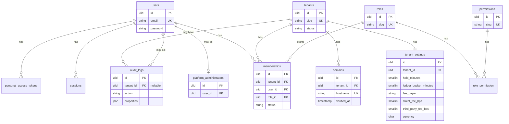

# Schema

Spec Section 13 lists the entities. This document says which of them exist in MySQL today. Timezone belongs on `locations`. Every timestamp that is stored is UTC.

## Migrated now

`users.id` is a ULID. `sessions.user_id` and Sanctum's `personal_access_tokens.tokenable` use ULIDs as well. `audit_logs.tenant_id` is nullable because platform actions are not tenant-owned. Roles and permissions are system rows, not per tenant.

`tenant_settings` stores fee rates and payer, hold length, ledger bucket, currency, and `pay_at_pickup` (default false). Currency defaults to `USD` and is not writable by a tenant until launch markets are decided. Fee rates are writable only by a platform administrator. The fee calculation engine is not in the database. `pay_at_pickup` is changed by a member with `settings.update`. The demo shop seeder sets it for Harbor Demo and Inland Demo only.

`tenant_brandings` stores the workspace display name, an optional external `logo_url` or a private `logo_path` on the local disk, `primary_color` and `accent_color` (`#RRGGBB`), and optional support email and phone. Defaults are the workspace name, `#0E7C86`, and `#F26B3A`. `GET` and `PATCH /api/v1/branding` read and update that row for the workspace resolved from the host. `GET /api/v1/branding/logo` serves the uploaded file for that same host and ignores any other path. Owner and manager (`settings.update`) can change it. Staff (`settings.view`) can read it. A new workspace gets a row when it is created. Existing views receive the current workspace as `workspaceBranding` from a view composer. Layouts are unchanged until they read that variable.

`tenant_notification_settings` stores `reply_to`, `staff_alert_recipients` (up to 20 email addresses), and `transactional_emails`. Every known kind starts on: `booking.confirmed`, `booking.cancelled`, `booking.guest_cancelled`, `booking.guest_rescheduled`, `booking.checked_out`, `booking.returned`, `booking.reminder`, `payment.completed`, `payment.failed`, `refund.issued`, `rental.overdue`, and `waitlist.promoted`. `GET` and `PATCH /api/v1/notification-settings` use the same owner and manager permission. A partial `transactional_emails` object changes only the kinds it names. Notification hooks are still queued. `App\Services\Notifications\TransactionalEmailPreferences` is what a mailer checks before it sends.

Foundation migration: `database/migrations/2026_10_23_170000_create_foundation_tables.php`. Laravel cache, jobs, and sessions tables are also migrated.

## Inventory resources

`locations.timezone` is the IANA zone for that place. Tenants do not have a timezone. `assets` are individually tracked and `pools.quantity` is the live capacity. Buffers are minutes on the asset or pool. Status is `active`, `blocked`, `maintenance`, or `retired`. `assets.replacement_asset_id` is empty until `POST /api/v1/assets/{asset}/retire` names another active asset in the same category and location. A retired asset stays in the workspace. A pool cannot be retired.

`availability_schedules` belong to a location, asset, or pool (`owner_type`, `owner_id`). `weekday` is Carbon's `0` Sunday through `6` Saturday. `blackouts.location_id` null covers the whole tenant. `services.kind` is `rental` or `tour`. `services.min_participants` and `services.max_participants` are optional. `services.waitlist_enabled` allows a refused hold to be stored as a waitlist entry. `service_durations` name a rental length (`minutes` or `hours`) and store `duration_minutes`. `resource_requirements` point at one asset or pool. `service_variants` name another way to book that service: `duration_minutes` and an optional `price_override_cents`. `service_variant_resources` map one variant to an asset or pool of a resource category. `quantity` is the units, and `capacity` is how many participants one unit covers. An empty mapping uses the service requirements. `assets.is_guide` marks a bookable guide. `assets.turnaround_minutes` and `pools.turnaround_minutes` are the gap after a rental. `departures` are scheduled tour times, with `private` and optional `seats`.

## Bookings and the capacity ledger

`customers`, `bookings`, `booking_line_items`, `allocations`, `holds`, and `capacity_ledger` are migrated in `database/migrations/2026_10_23_193000_create_booking_tables.php`. `POST /api/v1/bookings` stores `customer_phone` on the customer. A later booking with the same email fills `phone` only when it is still empty. Booking JSON includes `customer_id` and `customer`.

A booking stores the customer interval in UTC, party size, status, payment status, and operational status. `bookings.service_variant_id` is empty unless the hold named a variant. `waitlist_entries.service_variant_id` is the same choice, so a promotion holds that variant. `add_ons` is the workspace catalog of optional add-ons and equipment fees. `kind` is `addon` or `equipment`. `pricing` is `flat` (once per booking), `per_person` (the unit price times the party size), or `each` (the unit price times a quantity, capped by `max_quantity` or 100). Names are unique per workspace. `inventory.view` can read the catalog. `inventory.manage` can change it. A catalog row that is already on a booking cannot be deleted. Mark it inactive instead. An inactive row cannot be chosen again. `booking_add_ons` stores the lines chosen on `POST /api/v1/bookings` or on the first `POST /api/v1/bookings/{booking}/pricing`. Each line copies the name, kind, pricing, unit price, quantity, and total. A later catalog price change does not rewrite those lines. A per-person line's total is that stored unit price times the current party size. `POST /api/v1/bookings/{booking}/party-size` rewrites that total. Flat and each lines stay at the total that was chosen. The pricing snapshot keeps the previous add-on total until increase checkout or a decrease refund. A pricing request that sends `add_ons` replaces the lines until a snapshot exists. A pricing request that omits them keeps the hold's lines. A second quote returns the first snapshot. `operator_fees` is the catalog of required charges, such as cleaning or fuel. A row belongs to one service or one location. `pricing` is `flat` (once per booking), `per_person` (the unit price times the party size), or `percent` (`percent_bps` of the pre-discount service total, half-up to the cent). `amount_cents` is set only for a flat or per-person row. Names are unique per workspace. `inventory.view` can read the catalog. `inventory.manage` can change it. A catalog row that is already on a booking cannot be deleted. Mark it inactive instead. An inactive row is not applied again. `booking_operator_fees` stores the lines applied on `POST /api/v1/bookings` and refreshed on the first `POST /api/v1/bookings/{booking}/pricing`. Each line copies the name, scope, pricing, unit price or percent, quantity, and total. The pricing snapshot stores those lines and `mandatory_operator_fees_cents`. That amount is included in `basis_cents`. Tax and promo discounts stay on the service total. A party-size change recalculates per-person and percent lines from the snapshot. Flat lines stay as quoted. A catalog change after the snapshot does not rewrite them. `participants` is migrated in `database/migrations/2026_10_24_040000_create_participants_table.php`. Those rows name the people in that party. `bookings.participants` stays the party size used for inventory and is not a count of those rows. A row stores the name, whether the person is a minor, and the guardian's name when they are. The number of rows cannot exceed the party size. `POST /api/v1/bookings/{booking}/party-size` will not set the party size below that count. Only a held or confirmed booking can name a person. Booking JSON includes `named_participant_count`. A response that loaded the names also includes `named_participants`. `idempotency_key` is unique per tenant when set, with `payload_hash`. `GET` and `POST /api/v1/bookings/{booking}/participants` list and add them. `DELETE` removes a person who has not signed. A waiver signature may set `participant_id` and copies the name, the minor flag, and the guardian at that moment. Signing the same waiver version again returns the first signature. A signature can still be stored from a name alone, with `participant_id` empty. `departure_id` is set when the booking is for a tour departure. `guide_user_id` is the staff user guiding that booking. `created_by` is the member who placed the hold, when the request was authenticated. Idempotency is a unique `(tenant_id, idempotency_key)` plus `payload_hash`. `waitlist_entries` store a party that asked to wait. `booking_id` is set when that entry is promoted. Their idempotency key is unique per tenant and nullable. MySQL treats null keys as distinct, so bookings without a key do not collide. `allocations` and `holds` store the buffered interval, including turnaround. A hold counts only while `expires_at` is still in the future. `rental_checkouts` record an unreturned rental; `due_at` is the customer end, and `returned_at` null means the checkout still extends the block. `notification_hooks` record queued events such as `waitlist.promoted`. `capacity_ledger` is unique on `(tenant_id, pool_id, bucket_start_utc)`. Its counters are rewritten after a successful write and are not the admission check.

## Disclosure versions

`disclosure_versions` is migrated in `database/migrations/2026_10_23_200000_create_disclosure_versions_table.php`. It is tenant-owned and uses `BelongsToTenant`. Columns: `kind` (`booking_fee_refund_terms`), `version` (unique per tenant and kind), `fee_payer`, `rules_version`, `body` (one sentence per line), `content_hash`, and `published_at`. Rows are immutable: the model refuses updates and deletes. `pricing_snapshots.disclosure_version_id` records the version the customer saw.

## Pricing and payments

`price_rules`, `promo_codes`, `pricing_snapshots`, `stripe_accounts`, `payments`, and `platform_fees` are tenant-owned. `price_rules.local_start_minute` and `local_end_minute` are minutes from midnight in the booking location's timezone, or null when the rate has no clock window. The end minute is exclusive. An end before the start crosses midnight. `weekdays` is null, or a JSON list of Carbon weekdays (`0` Sunday through `6` Saturday) that further limits that clock window. A quote stores each window that won minutes on the pricing snapshot as `time_windows`, and the location-local start as `priced_local_start`. `webhook_events` is not: Stripe calls the platform host before a tenant is known, and `stripe_event_id` is globally unique. A pricing snapshot is unique per booking. A Stripe account is unique per tenant and per `stripe_account_id`. A checkout session id is unique and nullable, so offline payments do not collide. `payments.idempotency_key` is unique per tenant when set, with `payload_hash` covering the booking and, for checkout, the success and cancel URLs. A repeated key with the same hash returns the original payment. A repeated key with a different hash is rejected. Webhook payments leave both columns null. A repeated checkout does not open a second Stripe session; the session URL is returned only on the first call. `stripe_fee_id` is unique and nullable until `application_fee.created` arrives. `card_payments_status` starts at `pending` and must be `active` before online checkout.

## Booking widget tokens

`widget_tokens` stores the SHA-256 hash of an embed token. The plain token is returned once when a member with `bookings.manage` creates it. `revoked_at` or a past `expires_at` makes the public booking pages 404. The token is not a cookie and is not a Stripe secret. `tenant_settings.guest_cancel_before_minutes` is null until the workspace turns guest cancellation on. `notification_hooks.dedupe_key` is unique when set, so a repeated guest cancel does not queue a second hook.

## Operations

`maintenance_windows` name one asset or one pool and a half-open interval. Creating one sets `bookings.attention_reason` on future held and confirmed bookings whose allocations overlap that resource. It does not cancel them. `GET /api/v1/maintenance-windows` lists them. `maintenance_records` are inspections of one asset: `inspected_at` and a `summary`. `GET` and `POST /api/v1/assets/{asset}/maintenance-records` read and write them. They do not change the asset status and they do not cancel bookings. `incidents` store a short summary and `occurred_at`. `GET /api/v1/bookings/{booking}/incidents` lists the incidents for that booking. `waiver_versions` are unique on `(tenant_id, name, version)` and store `content_hash`. `waiver_signatures` copy that hash and store IP, user agent, an optional `participant_id`, and a guardian name when the participant is a minor. `GET /api/v1/bookings/{booking}/waivers/{signature}` returns a PDF of that record and the template text. It does not decide how long the signature is kept. `tenant_settings.late_fee_per_minute_cents` is null until set. `rental_checkouts.late_fee_cents` is the stored whole-minute amount and is not a Stripe charge. `rental_returns` stores one row per checked-out asset when a return sends `conditions`: `condition` is `ok`, `damaged`, or `missing`, with `notes` and `recorded_by` (the authenticated staff user). `POST /api/v1/bookings/{booking}/returns` and `POST /api/v1/bookings/{booking}/return` both write those rows and finish the return. `GET /api/v1/bookings/{booking}/returns` lists them. A `damaged` asset is set to `maintenance` and future held and confirmed bookings are flagged by the same path as an asset status change. That flag does not cancel them. `ok` and `missing` leave the asset status unchanged. Omitting `conditions` still returns the rental and stores no condition rows. `POST /api/v1/assets/{asset}/retire` sets that asset to `retired` and may store `replacement_asset_id`. Future bookings that use it are flagged by the same path as a status change to maintenance or blocked, and they are not cancelled. When a replacement is sent, the response lists each future confirmed booking for `POST /api/v1/bookings/{booking}/reassign`. That call is what moves the booking. The asset row, its maintenance records, and earlier allocations stay.

## Reports

`GET /api/v1/reports/today` and `GET /api/v1/reports/today/export` read live rows. `GET /admin` redirects to `/staff`. A booking counts on the calendar date of `starts_at` in its location timezone. Gross, tax, and the booking fee on that date come from those bookings' pricing snapshots. Card payments, offline payments, and customer refunds count on the day the row was recorded, in the report timezone. Open and overdue checkouts are current, not limited to that date. The net booking-fee total on this report is all time. That live read does not compute utilization, conversion, or revenue per resource-hour.

`report_summaries` stores one row per location per local date. `reports:build-summaries` rewrites yesterday and today for each active or onboarding workspace, using that location's timezone. `GET /api/v1/reports/summaries` reads an inclusive `from`/`to` window and does not rebuild the rows. Available minutes are the location's open minutes that day times active assets plus active pool quantity. A location with no hours is open for the whole local day, which is 23 or 25 hours when daylight saving starts or ends. A blackout, or a weekday the hours do not cover, has no available minutes. Overlapping hours are counted once. Allocated minutes are the overlap of allocations with those open intervals, times quantity. Utilization and conversion are basis points, rounded half-up. Conversion uses bookings created that local day; confirmed and no-show bookings are the numerator. Average order value uses `customer_total_cents` when the snapshot has it, otherwise the service total. Revenue per resource-hour uses the gross service cents of confirmed and no-show bookings that start that day, divided by available resource-hours. A day with no available minutes stores empty utilization and empty revenue per hour. `GET /api/v1/reports/revenue` reads confirmed and no-show bookings in an inclusive `from`/`to` window of at most 366 days and groups `services_cents`, or `basis_cents` when that is missing, by service and by the location-local date of `starts_at`. Taxes, the booking fee, and the customer total are not included. Held and cancelled bookings are not included. The sum for one location on one date is the same figure `report_summaries.gross_cents` stores. The read does not write a summary row. `GET /api/v1/reports/customers` uses the same window and the same confirmed and no-show bookings. A customer is new on the location and local start date of their earliest counted booking, ordered by `starts_at` and then by id. A later counted booking is a repeat. A booking with no customer is anonymous and is not a customer. Held and cancelled bookings are left out, including as earlier history. Attribution is the pricing snapshot `channel` when it is `direct` or `third_party`, and `unrecorded` otherwise. The read does not write a summary row. `GET /api/v1/reports/tours` lists each departure whose location-local start date falls in that same window. Capacity is the departure `seats`, or the service `max_participants` when seats are empty, or zero when both are empty. Seats booked are the participants on confirmed and no-show bookings. Seats attended are the confirmed participants. No-show seats are the no-show participants. Fill rate is booked seats over capacity, in basis points, rounded half-up, and is empty when capacity is zero. Attendance rate is attended seats over booked seats, in basis points, rounded half-up, and is empty when no seats are booked. Held, expired, and cancelled bookings are left out. The local start time is the departure `starts_at` in the location timezone. The read does not write a summary row. `GET /api/v1/reports/operations` uses that same inclusive window of at most 366 days. Each row is one location and the location-local date. Confirmed, cancelled, and no-show bookings are counted from `starts_at` in the location timezone. Held bookings and every other status stay out of the rates. Cancellation rate and no-show rate are basis points of those counts over the three statuses, rounded half-up. Both rates are empty when that day has none of the three. Tax is `tax_cents` on the pricing snapshots of confirmed and no-show bookings that start that day. A held or cancelled booking does not add tax. Captured card payments are paid `stripe` payments, and offline payments are paid `offline` payments. Customer refunds are `customer_refund_cents`. Fees charged are `platform_fees.amount_cents`. Fee refunds are `application_fee_refund_cents` plus `platform_fee_refunds.amount_cents`. Payments, refunds, and fees use the location-local date of `created_at` on the booking's location. A snapshot `fee_cents` is not added. The read does not write a summary row. The live today report is unchanged. `GET /api/v1/reports/summaries/export`, `GET /api/v1/reports/revenue/export`, `GET /api/v1/reports/customers/export`, `GET /api/v1/reports/tours/export`, and `GET /api/v1/reports/operations/export` return those same rows as CSV. An empty utilization, conversion, average order, revenue-per-hour, fill rate, attendance rate, cancellation rate, or no-show rate cell stays blank. The customer file marks each line `customer` or `attribution`. These reads do not write a summary row. `GET /api/v1/platform/fee-reconciliation` reads stored fee rows for a required UTC window and compares them with Stripe. It does not add a summary row.

## Integration outbox

`integration_outbox` queues a GoHighLevel event for the current workspace only. `dedupe_key` is unique per tenant when set. `attempts` and `available_at` are the backoff. `status` stays `queued` until five attempts, then `held`. Nothing in this table is sent to HighLevel. `notification_hooks.delivery_status` stays `queued` until `integrations:dispatch` marks it `skipped` with `delivery_error` because no email provider is configured. Kinds written by the booking engine are `booking.confirmed`, `booking.cancelled` (staff and API cancel; guest self-service stays `booking.guest_cancelled`), `booking.checked_out`, `booking.returned`, `rental.overdue`, `payment.completed`, and `payment.failed`. `payment.completed` is written once per payment row when an offline payment is recorded or a paid checkout webhook is fulfilled. `payment.failed` is written for `checkout.session.async_payment_failed` and does not confirm, cancel, or change the payment row. It is not written when that checkout session is already `paid`, so a failure that arrives after the paid event leaves the booking confirmed. An unpaid `checkout.session.completed` does not confirm the booking. A later `checkout.session.async_payment_succeeded` with `payment_status` `paid` does. `rentals:flag-overdue` writes `rental.overdue` once per open checkout whose `due_at` is in the past. `GET /api/v1/notification-hooks` lists the latest hooks for the current workspace. `booking.returned` includes `conditions`, one object per asset with `asset_id`, `condition`, `notes`, and `recorded_by`. A return that omits `conditions` queues an empty list. No mail is sent.

## Booking reminders

`tenant_settings.reminder_offsets_minutes` stores a workspace list of minute offsets before a booking starts. Null means 1440 and 120. An empty list turns reminders off. A workspace may store up to eight distinct offsets from 1 to 10080 minutes. `GET` and `PATCH /api/v1/booking-reminder-offsets` require `reminders.manage`. Owner and manager have that permission. Staff do not.

`booking_reminders` is unique on `(booking_id, offset_minutes)`. `bookings:dispatch-reminders` is scheduled every five minutes. It visits active and onboarding workspaces and queues `booking.reminder` once the elapsed offset has passed and `starts_at` is still ahead. Cancelled, held, and already-started bookings are skipped. The hook stores the location timezone and the local start. A log or array mailer marks the hook skipped and does not send email. A delivering mailer sends one notification when the booking has a customer email and the workspace still has `booking.reminder` on. Turning that preference off still records the hook once and does not email.

## Refunds

A pricing snapshot may store `charged_basis_cents`, the subtotal the booking fee was charged on. It stays put when `basis_cents` is lowered by a price-decrease refund, and it grows when a later price increase is paid. Refunds use it as the proportional denominator when it is present. `refunds` stores one Section 7.7 outcome: the reason, the customer amount, the application fee amount, the subtotal and tax that were refunded, and the Stripe refund ids when a call was made. `idempotency_key` is unique per tenant when set. The row is written only after Stripe accepts the call, or immediately when the reason refunds nothing. `platform_fee_refunds` stores a platform administrator's fee refund, separate from those reason codes: the fee, the amount, the free-text reason, the rule `platform_manual`, the actor, and the Stripe fee-refund id. Its `idempotency_key` is unique per tenant when set. The row is written only after Stripe accepts the call. It does not refund the customer. `GET /api/v1/fee-ledger` reads these rows for the current workspace, grouped by booking. A Section 7.7 fee refund is shown on the booking's earliest platform fee. A manual refund is shown on the fee it names. Charged and refunded totals still come from `platform_fees`.

## Tenant data exports

`tenant_data_exports` records a private JSON file for one workspace. `path` is on the local disk, which is not public. `row_counts` is the number of rows written per table. Termination is refused while no completed file for that tenant is still on disk. The file omits passwords and the GoHighLevel private integration token. It does not delete the workspace.

## Customer data export and deletion

`customers.anonymized_at` is set when direct identifiers are removed. The customer row stays, and `bookings.customer_id` still points at it. `customer_data_exports` records a queued, completed, or failed zip for one customer. `path` is on the local disk under `customer-exports/{tenant_id}/`. `row_counts` is the number of JSON values per file, and the manifest is not counted. The customer object counts as one. `GET /api/v1/customers/{customer}/exports/{export}/download` requires a signature and does not require a session. The signature expires 30 minutes after it is minted. `customer_data_deletions` is unique per tenant and customer. `confirmed` is true when deletion ran without an export file. `export_id` points at the completed export when one was on disk. Signed waiver rows are not deleted. How long they are kept is still open question 3.

## Outbound webhooks

`webhook_endpoints`, `webhook_deliveries`, and `webhook_delivery_attempts` are tenant-owned. An owner or manager with `webhooks.manage` registers an HTTPS URL and the events it receives: `booking.created`, `booking.cancelled`, `booking.changed`, `payment.succeeded`, and `refund.created`. `webhooks.view` reads the endpoint and the delivery log. Staff have neither permission. The signing secret is encrypted and is returned only by `POST /api/v1/webhook-endpoints`. Later reads omit it. `url_hash` is the SHA-256 of the URL and is unique per workspace. A private, loopback, or link-local address is refused when the endpoint is saved and again before each delivery. `DeliverWebhook` is queued on the database connection. It signs the raw JSON body with HMAC-SHA256 and retries a failed attempt up to five times, with delays of 30 seconds, 2 minutes, 10 minutes, and 30 minutes. Each attempt stores the status, response code, duration in milliseconds, and at most 2,000 characters of the response body. `GET /api/v1/webhook-deliveries` lists that log. `POST /api/v1/webhook-deliveries/{webhook_delivery}/redeliver` queues a finished delivery again. A pending delivery is left alone. These tables do not call GoHighLevel.

## GoHighLevel sub-account link

`ghl_connections` stores one BrandWorx sub-account per workspace. `tenant_id` is unique. `location_id` is that sub-account's Location ID. `private_integration_token` is encrypted with the application key and is hidden from array and JSON serialization. Platform administrators link, replace, and remove it. Tenant staff cannot. The workspace export includes the location id and omits the token.

`ghl_sync_logs` is one row per attempt: `booking.created`, `booking.changed`, `booking.cancelled`, `payment.succeeded`, or `connection.test`. It stores `attempt`, `status` (`succeeded`, `failed`, or `skipped`), `http_status`, `location_id`, and a short `error`. It does not store request or response bodies. Nothing is queued when the workspace has no link.

The client calls `https://services.leadconnectorhq.com` with `Authorization: Bearer` and `Version: 2021-07-28` unless `GHL_VERSION` is set. It upserts `POST /contacts/upsert` without tags, then `POST /contacts/{id}/tags` and `POST /contacts/{id}/notes`. The generic `integration_outbox` still does not call HighLevel. `webhook_delivery_attempts` remains the tenant endpoint log and is not reused here, because each row requires an endpoint and stores a response body.

## Planned, not migrated

These Section 13 tables are design-only. Do not infer columns beyond the spec and [`ALLOCATION.md`](ALLOCATION.md):

- service-level tax rows beyond the snapshot's tax basis points, and discount tables beyond `promo_codes`
- a waiver retention job. Signed waivers can be downloaded as PDF. How long they are kept is still open
- a mail transport. Outbound webhook endpoints are migrated
- ghl_mappings. Upsert matches the contact by email or phone in the linked location. A stored HighLevel contact id is not migrated
- a general integration_logs table. This sync records attempts on `ghl_sync_logs`
- inbound HighLevel webhooks and the rest of the Section 8 event list: reminders, check-in, return, overdue, and payment failed

Tenant-owned planned tables get `tenant_id`, foreign keys, and the indexes their queries need. Allocation overlap queries and the ledger unique key are the hot ones. Idempotency for bookings and payments is a unique `(tenant_id, idempotency_key)` plus a payload hash.

## Tenant scope

Models that use `BelongsToTenant` get a global scope. With no current tenant the scope is `whereRaw('0 = 1')` unless platform code calls `withoutGlobalScope`. Creating a tenant-owned row without a tenant id in the attributes and without a current tenant throws. An explicit null `tenant_id` is preserved for `audit_logs`.
